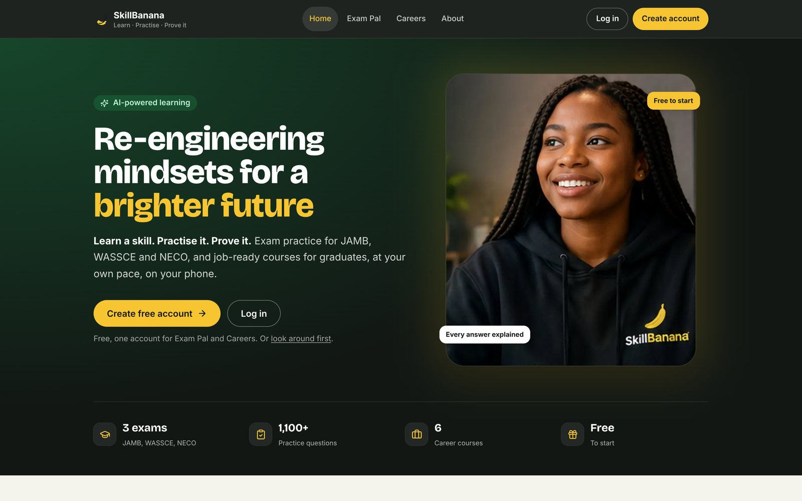
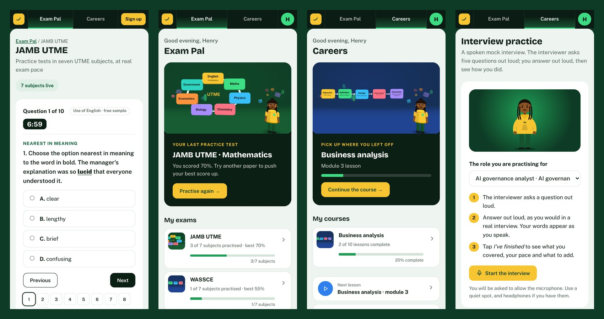
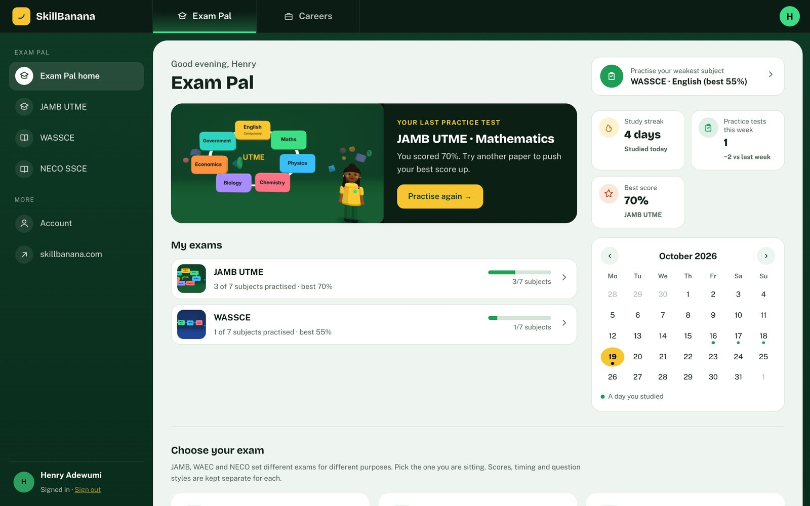
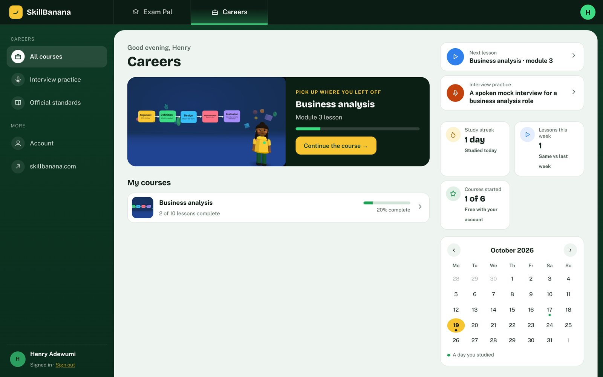
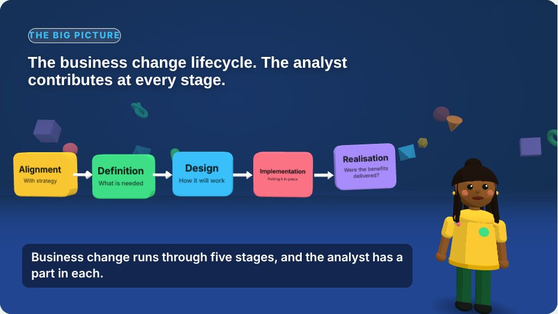
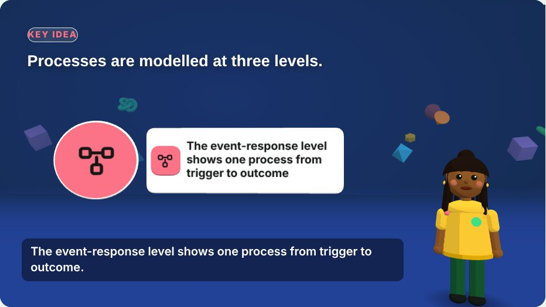
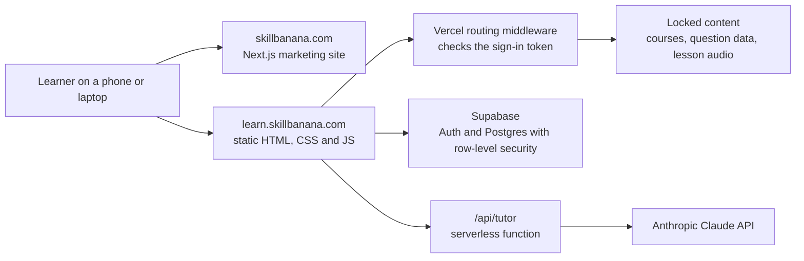

  

<h1 align="center">SkillBanana</h1>

  <strong>Learn a skill. Practise it. Prove it.</strong> 
  Free exam practice for JAMB, WASSCE and NECO, and job-ready career courses, built for learners in Nigeria and across Africa.

  <a href="https://skillbanana.com"><strong>skillbanana.com</strong></a> ·
  <a href="https://learn.skillbanana.com"><strong>learn.skillbanana.com</strong></a>

---

## What it is

SkillBanana is a study platform with two separate spaces. Each one has its own dashboard, scores and progress, and one free account works in both.

| | **Exam Pal** | **Careers** |
|---|---|---|
| **Who it's for** | Secondary school students | Graduates and career changers |
| **What you get** | Timed practice papers for **JAMB UTME, WASSCE and NECO SSCE**, seven subjects each, with every answer explained | Six courses, each tied to an entry-level job: business analysis; data analysis (Excel, SQL and Power BI); digital marketing (to the Meta Certified Digital Marketing Associate study guide); project management; PRINCE2 Foundation; AI governance, risk and compliance |
| **How you practise** | Tests at real exam pace, scores by topic, theory questions with model answers and marking points | Narrated 3D lessons, knowledge checks, practice tasks, a final peer review, skill badges and a certificate of completion |
| **Help when stuck** | An AI tutor that explains any question another way | The same AI tutor, plus spoken mock interviews |

All exam questions are original practice questions written to each published syllabus: 1,104 multiple-choice and 78 theory questions. They are not past papers, and SkillBanana is not endorsed by JAMB, WAEC, NECO or any awarding body.

## Screens

  

**Exam Pal dashboard.** Your last test, your exams, your weakest subject and your study streak.

**Careers dashboard.** The course you're on, your next lesson and interview practice.

**Narrated 3D lessons.** Diagrams, cards and a presenter move in time with the narration, with captions, transcript and chapters.

  
  

The dashboard screenshots use sample learner data.

## What makes it different

- **Practice, not just videos.** Learners answer questions under time pressure, rehearse interview answers out loud and get feedback straight away.
- **Built for phones and patchy data.** Light pages with no framework on the learning site, tested down to 320px screens.
- **Kept separate on purpose.** JAMB, WASSCE and NECO each have their own questions, timing and saved scores, and Exam Pal and Careers each have their own space.
- **Honest by design.** No fake reviews, no invented learner numbers, and plain statements of what the platform does not do yet.

## How it's built

| Part | Stack |
|---|---|
| Learning site | HTML, CSS and JavaScript, generated by Python build scripts, no front-end framework |
| Lessons | three.js real-time 3D scenes synced to narration; narration generated with an open-source text-to-speech model |
| Accounts and data | Supabase: Postgres, Auth (email and Google sign-in) and row-level security |
| AI tutor | Vercel serverless function calling Anthropic's Claude API, with rate limiting and topic limits |
| Voice practice | Browser speech recognition and speech synthesis; audio is not recorded or stored |
| Access control | Vercel routing middleware checks the sign-in token before serving locked content |
| Marketing site | Next.js 14, TypeScript, Tailwind CSS |
| Hosting and analytics | Vercel, Vercel Web Analytics |

## Status

Live and free to use. In early testing with the first learners.

- **Live now:** Exam Pal for JAMB, WASSCE and NECO in seven subjects each; six Careers courses with a job kit for each role; the AI tutor; spoken interview practice; certificate checking.
- **Not yet:** internship or job placement, paid plans, and published learner results. Results will be published once they are real.

## About

Built and run by **Henry Adewumi**, founder of SkillBanana.

✉️ [hello@skillbanana.com](mailto:hello@skillbanana.com) · 🌐 [skillbanana.com/about](https://skillbanana.com/about)

---

This repository is a public showcase. The application source code is private. © 2026 Henry Adewumi. All rights reserved. PRINCE2 is a registered trade mark of PeopleCert.
